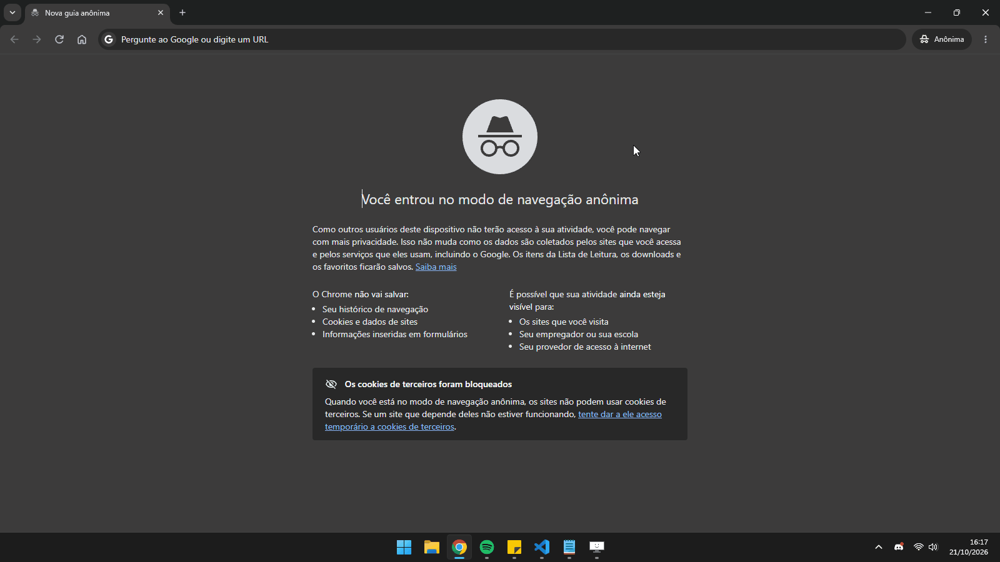

# 📌 PinDesk

Fixa qualquer janela do Windows **sempre no topo**: Bloco de Notas, navegador, player de vídeo, calculadora, o que for. Fica rodando na bandeja do sistema e não precisa instalar nada.

<!-- Grava um GIF curto usando o app, salva em docs/demo.gif e tira o comentário da linha abaixo -->
<!--  -->

## Funcionalidades

- **Clique e fixe**: clica no alfinete da bandeja, a tela escurece e a janela embaixo do mouse fica destacada. Um clique e ela fica fixada.
- **Atalho global**: `Ctrl+Alt+P` fixa ou desafixa a janela ativa.
- **Botão de desafixar**: toda janela fixada ganha um botãozinho vermelho na barra de título, que acompanha a janela enquanto ela se move.
- **Menu da bandeja**: lista as janelas abertas (as fixadas aparecem marcadas), tem a opção de desafixar todas e a de iniciar com o Windows.
- **Funciona com vários monitores e escalas diferentes** (DPI por monitor).
- **Leve**: um único `.exe` de poucos KB, sem dependências além do .NET Framework, que já vem no Windows 10/11.

## Download

Baixa o `PinDesk.exe` na página de [Releases](../../releases) e abre. Ele vai pra bandeja (a setinha `^` perto do relógio).

> O Windows SmartScreen pode avisar que o app é de um editor desconhecido, porque o exe não é assinado. Clica em *Mais informações* > *Executar assim mesmo*.

## Como usar

| Ação | Como |
|---|---|
| Fixar uma janela | Clique esquerdo no alfinete da bandeja, depois clique na janela |
| Fixar a janela ativa | `Ctrl+Alt+P` |
| Desafixar | Botão vermelho na barra de título, `Ctrl+Alt+P` de novo, ou pelo menu |
| Cancelar a escolha | `Esc` ou botão direito |
| Menu | Clique direito no alfinete da bandeja |

Ao sair pelo menu, todas as janelas são desafixadas.

Janelas abertas como administrador só podem ser fixadas se o PinDesk também estiver rodando como administrador (limitação do próprio Windows).

## Compilar

Não precisa de Visual Studio nem do SDK do .NET: o build usa o compilador C# (`csc.exe`) que já vem com o .NET Framework 4.x do Windows.

```powershell
.\build.ps1
```

Ou dá dois cliques no `build.bat`. O `PinDesk.exe` é gerado na raiz do projeto.

## Como funciona

| Arquivo | O que faz |
|---|---|
| [`PinManager.cs`](src/PinManager.cs) | Fixa e desafixa as janelas (`SetWindowPos` com `HWND_TOPMOST`) e usa `SetWinEventHook` pra saber quando a janela fixada se move, ganha foco ou é minimizada |
| [`PinOverlay.cs`](src/PinOverlay.cs) | O botão de desafixar: uma janela sem borda que não rouba o foco, posicionada na barra de título e mantida logo acima da janela alvo na ordem Z |
| [`PickerForm.cs`](src/PickerForm.cs) | O modo de escolha: uma camada semitransparente sobre todas as telas que descobre a janela embaixo do cursor percorrendo as janelas com `EnumWindows` |
| [`TrayApp.cs`](src/TrayApp.cs) | Ícone e menu da bandeja, atalho global (`RegisterHotKey`) e a opção de iniciar com o Windows (registro `Run`) |
| [`IconArt.cs`](src/IconArt.cs) | Desenha o alfinete com GDI+: ícone da bandeja, cursor, botão e o `.ico` do exe |
| [`WinUtil.cs`](src/WinUtil.cs) / [`Native.cs`](src/Native.cs) | Funções auxiliares e as declarações P/Invoke da API Win32 |

## Licença

[MIT](LICENSE)
